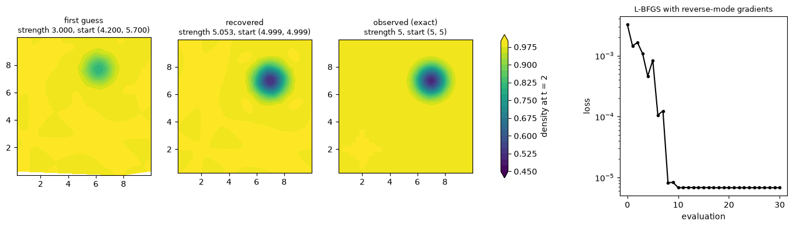

# differentiable-voronoi-fluids

A 2D compressible Euler solver on an Arepo-style moving Voronoi mesh, written in JAX so
that reverse-mode autodiff runs through a whole simulation, mesh motion included. It is a
prototype of the approach, ported from the periodic-box core of
[voroflow](../voroflow): no walls, no refinement, hydro only.



## How it stays differentiable

Which seeds are neighbors is piecewise constant in their positions, and nothing useful can
be differentiated through a Delaunay triangulation. So the solver splits the mesh in two:

- **Connectivity, on the host.** `mesh.topology` calls SciPy's Delaunay (Qhull) through
  `jax.pure_callback` on gradient-stopped positions, with periodic images of the seeds near
  the box edges, and returns integer arrays: for each Voronoi face, its two cells, the
  periodic offset between them, and the two Delaunay triangles whose circumcenters are its
  ends. A Delaunay triangulation of N points on a torus has exactly 3N edges, so the arrays
  never change shape and nothing recompiles when the mesh flips.
- **Geometry, in JAX.** Face ends are circumcenters of the triangle corners, and face
  lengths, normals and midpoints, cell areas and centroids follow from them. All of it is a
  smooth function of the seed positions while the connectivity holds.

Everything downstream is ordinary JAX: least-squares gradients with a Barth-Jespersen-style
limiter, Springel's face velocity, HLLC in the moving face frame, seeds that follow the gas
plus centroid steering, and the two-stage Heun step of Pakmor et al. (2016), with the mesh
rebuilt at both stages. The time step is fixed for a run. `solver.run` scans the steps with
each one under `jax.checkpoint`, and with `segment=k` checkpoints every k steps as well, so
reverse mode stores about n / k + k states instead of n.

The derivative is exact for the connectivity and limiter branches the forward run chose. At
a mesh flip the face that appears or vanishes has zero length, so the fluxes are
continuous there and only their derivatives jump: the loss is piecewise smooth, which
gradient-based optimizers handle.

## Results

**Forward accuracy.** The isentropic vortex carried once across a periodic box of side 10
to t = 2 (`examples/vortex_convergence.py`):

| Cells | Steps | L1 density error | Order | voroflow (Rust) |
| --- | --- | --- | --- | --- |
| 32² | 68 | 1.377e-3 | | 1.406e-3 |
| 64² | 135 | 3.361e-4 | 2.03 | 3.277e-4 |
| 128² | 269 | 8.335e-5 | 2.01 | 8.931e-5 |

**Gradients.** Reverse mode agrees with central finite differences to about 1e-11 relative,
and with forward mode (`jax.jvp`) to the last digit, on a run whose stream velocity is one
of the parameters, so the derivative passes through the seed motion. Checkpointing every 5
steps gives the same gradient to 1e-12. A value with its gradient costs 2.5 times a forward
run at 32² and 2.2 times at 64².

**Inverse problem** (`examples/vortex_inverse.py`). Observe the exact density at t = 2 of a
vortex of strength 5 that started at (5, 5); start L-BFGS from strength 3 at (4.2, 5.7); let
reverse-mode gradients through the 68-step run do the rest. It recovers strength 5.053 and
start (4.9993, 4.9987) in 31 evaluations, 41 s on a laptop CPU at 32². The remaining loss,
6.8e-6, is the solver's own discretization error; the 1% excess in strength makes up for
the numerical dissipation that flattens the vortex.

## What it took

- **Cocircular seeds.** On a lattice, four seeds share a circle and the triangulation has a
  free choice of diagonal. Qhull made it differently in different periodic copies, the
  edges stopped pairing up, and the face count missed 3N. Triangulating positions nudged
  by 1e-7 of the spacing, the same nudge for every copy of a seed, fixes the choice; the
  faces it decides have zero length either way.
- **NaN gradients from branches not taken.** `jnp.where` evaluates both sides, and the
  gradient of the discarded side is multiplied by zero. If that side's derivative is
  infinite, 0 times infinity is NaN. The limiter divides by the change a gradient makes at
  a face, which is exactly zero in uniform gas: the forward pass clipped the ratio away,
  but its derivative 1 / dw² was infinite. Denominators are kept at least 1e-100 from zero
  (so their squares stay finite), and changes too small to matter skip the ratio entirely.
- **Zero-length faces.** Norms add 1e-300 under the square root, so their gradient at zero
  is 0 rather than NaN.

## Layout

| File | Contents |
| --- | --- |
| `dvf/mesh.py` | periodic Delaunay connectivity on the host, Voronoi geometry in JAX |
| `dvf/hydro.py` | state conversion, HLLC, moving-face flux |
| `dvf/solver.py` | limited gradients, seed motion, the step, checkpointed runs |
| `dvf/problems.py` | lattice seeds, isentropic vortex |
| `examples/vortex_convergence.py` | forward accuracy |
| `examples/vortex_inverse.py` | recover a vortex from its later density |
| `tests/` | mesh tiling and gradients, conservation, gradient checks |

## Running

```bash
uv sync
uv run --group dev pytest -q tests
uv run python examples/vortex_convergence.py
uv run --group dev python examples/vortex_inverse.py
```

## Limits and next steps

- The Delaunay triangulation runs on the CPU and costs two host round trips per step. For
  a GPU, keep the connectivity and test it in JAX (each edge's two opposite corners against
  its circumcircle), rebuilding only when the test fails.
- No walls yet. voroflow's conforming walls are seeds on circle intersections, a smooth
  function of the surface samples, so shape gradients (airfoil drag, say) would come
  without the noise of cut cells.
- No refinement: the cell count is fixed. Splits and merges would have to be decided on the
  forward pass and replayed.
- Chaotic flows (Kelvin-Helmholtz, Rayleigh-Taylor) make gradients over long windows blow
  up; they need short windows or averaged objectives.
